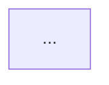
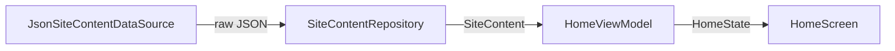

Open the pull request for the current branch.

Every PR this skill creates carries the same **fixed shape**: one sentence naming the problem it targets and a `Closes <issueLink>` line for each issue it resolves, one sentence for how it is solved, then a Mermaid **data-flow** diagram of the software components the diff touches — Dart, Kotlin, and Python files only.

- **Problem target** — one sentence, the thing that was wrong or missing, then one `Closes <issueLink>` line per issue the change resolves (none when the branch closes no issue).
- **How it is solved** — one sentence, the mechanism that fixes it.
- **Blast radius** — a `mermaid` data-flow diagram of the Dart, Kotlin, or Python components the diff touches, showing what data moves between them.

Short is the point. One sentence per section; the `Closes` line is a reference, not prose, and the diagram carries the structure that prose would spend a paragraph on. When the filtered diff touches no such file, say so in one line instead of drawing a diagram.

`local-feature-branch-pr` owns branch + commit. This skill starts once commits exist and owns only the PR.

## Process

### 1. Confirm there is something to open

```bash
git branch --show-current
git symbolic-ref --short refs/remotes/origin/HEAD    # → e.g. origin/master
git log origin/<base>..HEAD --oneline
```

Resolve `<base>` from `origin/HEAD`; if that fails, prefer `master` then `main`, and if both exist ask the user which one.

Stop with a one-line reason when any of these is true:

- The current branch **is** the base branch — nothing to open.
- `git log origin/<base>..HEAD --oneline` is empty — no commits ahead of base.

**Completion criterion:** a named head branch, a named base branch, and a non-empty commit list.

### 2. Make sure the head branch is on the remote

```bash
git rev-parse HEAD
git rev-parse origin/<head>          # may fail if never pushed
```

Push when the branch is missing upstream or the local commit differs:

```bash
git push -u origin <head>
```

**Completion criterion:** `origin/<head>` points at the same commit as `HEAD`.

### 3. Refuse to duplicate a PR

```bash
gh pr list --head <head> --json number,url,state --jq '.[] | select(.state=="OPEN")'
```

If an open PR already exists, stop and print its URL — do not create a second one. Offer to update its body instead.

**Completion criterion:** no open PR exists for `<head>`, or the run stopped.

### 4. Resolve the issues this closes

The `Closes` line is only as good as the link. Resolve it before writing the body, cheapest source first:

1. **The user's request** — if they named an issue (`#42`, an `.../issues/42` URL, or "closes 42"), that is authoritative. Use exactly the issues named there.
2. **The branch commits**:
   ```bash
   git log origin/<base>..HEAD --format='%s%n%b'
   ```
   Scan subjects and bodies for a GitHub closing keyword (`close`, `closes`, `closed`, `fix`, `fixes`, `fixed`, `resolve`, `resolves`, `resolved`) followed by `#N` or `owner/repo#N`. Plain mentions, `Refs`, and vague prose are not closing references.
3. **The branch name** — accept only an explicit `#N` or `owner/repo#N`. A bare number in a branch name is not an issue number.
4. **Ask once** — when none of the above names an issue, ask: "Which issue(s) does this PR close? Paste `#N`, `owner/repo#N`, or the issue link(s), or say none." Do not search issues by title and do not guess.

Verify each reference and read the issue so the problem sentence can use its vocabulary:

```bash
gh issue view <N> --json number,title,state,url
gh issue view <N> --repo <owner>/<repo> --json number,title,state,url   # another repository
```

Normalize to the exact body form: `#N` for an issue in the PR's repository, `owner/repo#N` for another one. Full issue URLs are not the documented closing syntax. Deduplicate and keep the order found; an already-closed issue stays in the list.

When `gh issue view` fails, the reference is wrong or inaccessible: ask the user. Do not substitute a nearby issue and do not invent one. If the user says there is none, keep the list empty — the body then omits the line.

**Completion criterion:** a deduplicated, verified list of issue references in their final body form, or an empty list after the user confirms there is no issue.

### 5. Read the data flow

This is the only step that needs judgement, so do it before writing a word:

```bash
git diff origin/<base>...HEAD --stat
git diff origin/<base>...HEAD --name-status
git log origin/<base>..HEAD --oneline
git diff origin/<base>...HEAD --name-only -- '*.dart' '*.kt' '*.py'
git diff origin/<base>...HEAD -- '*.dart' '*.kt' '*.py'
```

Only `.dart`, `.kt`, and `.py` files are software components for this diagram. Leave out everything else: Markdown, YAML/JSON, Gradle and other build/config files (including `.kts`), lockfiles, generated code (`*.g.dart`, `*.freezed.dart`, `build/`, `*_pb2.py`), and tests (`test/`, `tests/`, `*_test.dart`, `*Test.kt`, `test_*.py`). If that filtered diff is empty, skip the diagram and write: "No Dart, Kotlin, or Python components changed, so there is no data flow to map."

For each remaining file, name the component and the data it handles — models, DTOs, state objects, function parameters and return types, JSON payloads. Read the changed files and follow each data contract to the component that produces it and the component that consumes it; search the repository for the type or function name (`rg` or `git grep`, filtered to the three extensions) when the diff alone doesn't show the flow.

An adjacent unchanged component is allowed only as the producer or consumer an edge needs to land on; do not rebuild the whole architecture.

**Completion criterion:** every changed `.dart`/`.kt`/`.py` file is a node, an edge's data label, or a stated exclusion, and each node's data source and destination are identified where they exist.

### 6. Write the body

Write it to a temp file, never inline in the shell — backticks in a Mermaid block will execute.

````markdown
## Problem target

<one sentence>

Closes <issueLink>

## How it is solved

<one sentence>

## Blast radius


````

The block under `## Blast radius` is the data-flow map from step 7, not a dependency graph. When no software component changed, replace it with the one-line note from step 5.

`<issueLink>` is the reference resolved in step 4 — `#42`, or `owner/repo#42` for another repository. Write one `Closes` line per issue, each with its own keyword, and omit the line entirely when the list is empty. It is a reference, not a sentence: the two-sentence rule below counts only the prose. Put the line(s) directly under the problem sentence with a blank line around them, so the issue reads as the problem being targeted.

Rules for the two sentences:

- Exactly one sentence each, ending in a period, under ~25 words.
- **Problem target** names the problem, not the code: what was broken, missing, or risky before this branch.
- **How it is solved** names the mechanism: what now happens instead, in the same vocabulary as the repository.
- Read them back-to-back — if the second one only restates the first in the past tense, rewrite it.

### 7. Draw the data-flow diagram

The diagram exists so a reviewer sees how data moves through the components the change reaches without reading the diff. It follows the data, not the file tree — include only software components the diff touches (`.dart`, `.kt`, `.py`), plus one adjacent unchanged component only where an edge needs a producer or consumer to land on.

- Start with `flowchart LR`, so producer → consumer reads left to right; use `flowchart TD` for a branchy flow.
- One node per component that produces, transforms, or consumes data: screens, view models, services, repositories, data sources. Label it in human language: `repo["SiteContentRepository"]`. Keep ids short and lowercase.
- Data classes, DTOs, and state types are the data, not the components: put them on edges. Add a node only when the file itself does work (parsing, mapping, storing).
- Every edge runs from the component that produces the data to the component that consumes it, and is labelled with the data itself: `-->|SiteContent|`, `-->|raw JSON|`, `-->|HomeState|`. Do not label edges with reads, calls, or renders.
- Wrap every node label in double quotes; edge labels are already delimited by the pipes. Keep `(`, `)`, `[`, `]`, `{`, `}`, `<`, `>`, `|` and backticks out of both — unquoted or markup punctuation is the usual cause of a broken diagram. Write generics plainly (`User list`, not `List<User>`).
- Never use `end` as a node id. Avoid `classDef` and styling: the default theme already reads correctly on GitHub.
- Group with `subgraph` only when data genuinely crosses layers or languages (Dart UI → Kotlin shared → Python API), and give each subgraph a quoted title.
- Aim for 3–15 nodes. Collapse files that are one component, and leave out generated files, tests, build/config, and wiring-only code that carries no data.

For example:



**Completion criterion:** every changed `.dart`/`.kt`/`.py` file is a node, an edge's data label, or a stated exclusion (generated, test, wiring-only); every edge carries a concrete data name; every node has at least one edge; the block parses as valid Mermaid.

### 8. Create the PR

Derive the title from the commits in conventional-commit form (`feat(ui): add dark mode toggle`), under 72 characters.

```bash
gh pr create \
  --base <base> \
  --head <head> \
  --title "<title>" \
  --body-file /tmp/local-open-pr-body.md
```

If `gh` is missing or `gh auth status` fails, stop and say what to install or run.

**Completion criterion:** `gh pr create` exits 0 and prints a PR URL.

### 9. Verify and report

```bash
gh pr view --json url,body,baseRefName,closingIssuesReferences
gh repo view --json defaultBranchRef --jq .defaultBranchRef.name
```

Confirm the body has both sentence sections, one `Closes` line per issue resolved in step 4 (or none), and either a fenced `mermaid` block whose edges are data-labelled, or the one-line no-software-components note.

GitHub links closing keywords only when the PR targets the repository's default branch. When `baseRefName` differs from that branch, say plainly that the `Closes` lines are inert until the merge reaches the default branch.

When the base **is** the default branch and an issue was expected, confirm `closingIssuesReferences` lists each one. If it does not, rewrite the body once with `gh pr edit --body-file` and re-check; if it still does not, print the URL with an explicit warning that GitHub did not link the issue. Then print:

```
🚀 PR opened: <URL>
```

The skill is done when the URL is printed. Do not merge, do not request reviewers, and do not edit the PR after creation for any other reason unless the user asks.

## Edge cases

- **Empty diff after commits** — the branch is ahead but the merge-base diff is empty; report it and stop rather than opening an empty PR.
- **Detached HEAD** — ask which branch to open the PR from.
- **Base branch not fetched** — `git fetch origin <base>` before diffing.
- **No software components** — the filtered diff is empty; omit the Mermaid block and write the note from step 5. Keep the two sentences.
- **Only tests, generated code, or wiring** — same note; these files exercise or wire components but carry no product data flow.
- **No issue to close** — step 4 asked and the answer was none; omit the `Closes` line instead of inventing one.
- **Unresolvable issue reference** — `gh issue view` fails; ask the user, do not substitute a nearby issue.
- **Base is not the default branch** — GitHub ignores closing keywords; keep the line only as a reference and say it will not auto-close.
- **Several issues** — one `Closes` line each, every line carrying its own keyword; no bare `#10, #11` continuation.
- **Issue already closed** — keep the line; linking a closed issue is harmless.
- **Data flow leaves the diff** — include the nearest unchanged producer or consumer as one adjacent node only.
- **New type with no producer or consumer** — no edge exists; note it instead of inventing a node or self-edge.
- **Diagram won't render** — check for quoted-label mistakes, angle-bracket generics, a stray `end` id, or an unclosed `subgraph`; fix and re-verify with step 9.
